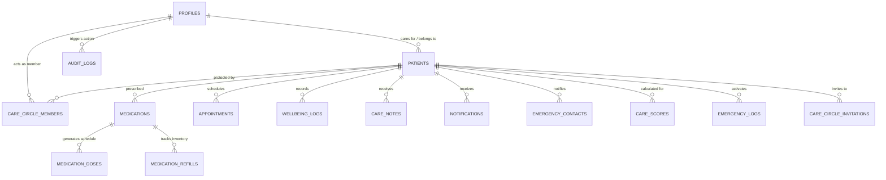
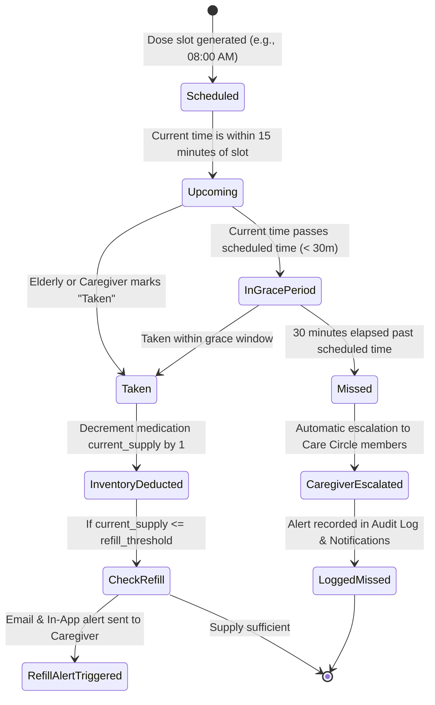

# CAREVERSE Architecture & Technical Specifications

> **AI-Powered Intelligent Elderly Healthcare Management Ecosystem**  
> Enterprise-grade, resilient, accessible full-stack healthcare platform engineered for high-consequence elderly care environments.

---

## 1. System High-Level Architecture

Careverse is architected around a decoupled, domain-driven, full-stack model ensuring high reliability, clinical safety, low latency, and zero-downtime offline/evaluator resilience.

```
+-----------------------------------------------------------------------------------+
|                                  CLIENT LAYER                                     |
|  React 18 + Vite + Tailwind CSS + Lucide Icons + Recharts                         |
|  - WCAG 2.2 AA A11y Engine (125% Text Scaling, High-Contrast Themes, Screen Read) |
|  - Trilingual i18n Engine (English, Tamil, Hindi)                                 |
|  - Multi-Role Dashboards (Elderly, Family Member, Caregiver, Administrator)      |
|  - Real-Time Floating CareBuddy AI with Web Speech API Audio Synthesis           |
|  - Emergency SOS Trigger Modal with 5-Second Cancellation Window                  |
|  - Visual Notification Simulator for Evaluators                                   |
+-----------------------------------------------------------------------------------+
                                       |
                           HTTPS REST API / JSON
                                       |
+-----------------------------------------------------------------------------------+
|                                 BACKEND LAYER                                     |
|  Node.js + Express + TypeScript                                                   |
|                                                                                   |
|  [Middleware Pipeline]                                                            |
|  - Security: Helmet, CORS, json parser                                            |
|  - Rate Limiting: 100 req/15min general, 10 req/15min auth/SOS                    |
|  - Authentication: JWT verify + Bearer tokens                                      |
|  - RBAC: Granular role & permission checks (view, meds, appts, notes, admin)      |
|  - Structured Audit Logger: append-only logging for sensitive clinical actions   |
|                                                                                   |
|  [Domain Services]                                                                |
|  - ReminderEngine: 60s background tick, 15m advance alerts, 30m grace escalation  |
|  - CareScoreService: Multi-factor daily health score (0-100)                      |
|  - CareBuddyService: Guardrailed AI assistant with rule-based fallback            |
|  - EmailService: Dual-mode (Resend API production + Visual Evaluator Simulator)   |
+-----------------------------------------------------------------------------------+
                                       |
                     Database Abstraction Layer (DAL)
                                       |
         +-----------------------------+-----------------------------+
         |                                                           |
+---------------------------------------+   +---------------------------------------+
|        PRODUCTION DATABASE            |   |      EVALUATION / OFFLINE ADAPTER     |
|  Supabase Managed PostgreSQL          |   |  Zero-Config File/Memory Adapter      |
|  - 15 Normalized Relational Tables    |   |  - Full Supabase interface parity     |
|  - Row-Level Security (RLS) Policies  |   |  - Atomic sync to disk storage        |
|  - Cascading Foreign Keys & Indexes   |   |  - Pre-seeded with Eleanor Vance demo |
+---------------------------------------+   +---------------------------------------+
```

---

## 2. Relational Database Schema & Entities

The platform data model comprises **15 normalized relational tables** mapped in `database/migrations/001_initial_schema.sql` and mirrored in the runtime DAL:



### Table Definitions & Roles

| Table Name | Primary Key | Description |
| :--- | :--- | :--- |
| `profiles` | `id (UUID)` | User accounts, hashed passwords, roles (`elderly`, `family`, `caregiver`, `admin`), phone, emergency notes. |
| `patients` | `id (UUID)` | Elderly patient demographics, medical history, blood group, allergies, primary caregiver link. |
| `medications` | `id (UUID)` | Prescriptions, dosage, schedule timings, remaining supply, refill threshold, prescribing doctor. |
| `medication_doses` | `id (UUID)` | Exact scheduled dose slots per medication, status (`scheduled`, `taken`, `missed`, `skipped`), administered timestamp and by whom. |
| `medication_refills` | `id (UUID)` | Historical and pending refill logs, quantity, pharmacy contact, status. |
| `appointments` | `id (UUID)` | Medical visits, doctor names, specialty, clinic location, appointment date/time, preparation notes. |
| `care_circle_members` | `id (UUID)` | Links users to a patient with granular permissions: `can_view`, `can_manage_meds`, `can_manage_appts`, `can_manage_notes`, `is_primary`. |
| `care_circle_invitations`| `id (UUID)` | Pending family/caregiver invites with SHA-256 hashed tokens and 7-day expiration dates. |
| `wellbeing_logs` | `id (UUID)` | Daily physical and emotional check-in entries (mood, sleep hours, pain level 1-10, symptoms, notes). |
| `care_notes` | `id (UUID)` | Shift notes, caregiver observations, and critical alerts with priority flags (`routine`, `important`, `urgent`). |
| `notifications` | `id (UUID)` | Dispatched in-app and simulated email alerts with read status and recipient mappings. |
| `emergency_contacts` | `id (UUID)` | Prioritized emergency contacts with direct phone, relationship, and priority ordering (1 = first called). |
| `care_scores` | `id (UUID)` | Daily aggregated Care Score (0-100) with sub-scores for medication adherence, check-ins, vitals, and social support. |
| `emergency_logs` | `id (UUID)` | Full audit record of SOS activations, cancellation timestamps, broadcasted contacts, and responder details. |
| `audit_logs` | `id (UUID)` | Immutable security audit trail recording IP address, user agent, action, entity type, and timestamp. |

---

## 3. Background Reminder & Notification Engine State Machine

The `ReminderEngine` operates on an asynchronous 60-second processing tick, enforcing clinical safety guarantees against double-dosing and missed medication schedules.



### Double-Dose Prevention Guarantee
- If a dose slot is already marked `taken`, subsequent calls to `/api/medications/doses/:id/take` are rejected with HTTP 400 (`"Dose already marked taken"`).
- The Dose Timeline component immediately transforms the action button into a disabled state displaying `"Taken at HH:MM"` with the admin profile name.

---

## 4. Daily Care Score Calculation Engine

The `CareScoreService` computes a holistic 0–100 health index daily, synthesized across 4 clinical dimensions:

$$\text{Care Score} = (\text{Adherence} \times 0.50) + (\text{Wellbeing} \times 0.25) + (\text{Care Circle} \times 0.15) + (\text{Notes} \times 0.10)$$

1. **Medication Adherence (50% Weight)**:
   - Evaluates all doses due up to the current hour.
   - $100\%$ score if all taken on time.
   - Drops proportionally for missed doses.

2. **Daily Wellbeing Check-In (25% Weight)**:
   - $100\%$ if check-in submitted today.
   - Adjusts for pain level (scores $< 4$ receive full marks; scores $> 7$ deduct 15 points).
   - Sleep quality factor (7-9 hours optimal; $< 5$ hours deducts 10 points).

3. **Care Circle Engagement (15% Weight)**:
   - Presence of at least one primary caregiver and verified emergency contacts.
   - Active invitations or lack of contacts reduces score.

4. **Caregiver Notes & Clinical Oversight (10% Weight)**:
   - Routine or positive observations maintain 100%.
   - Unresolved `urgent` care notes trigger a 25-point penalty until resolved.

---

## 5. CareBuddy AI Assistant Architecture & Guardrails

CareBuddy is designed with a defense-in-depth safety pipeline to assist elderly patients with health routines without ever providing dangerous medical diagnoses:

```
[User Natural Language Query (Voice or Text)]
                     |
                     v
   +------------------------------------+
   |   Input Pre-Filter & Sanitizer     |
   +------------------------------------+
                     |
                     v
     [Is Query an Emergency or Life-Threatening?]
         |                     |
        YES                   NO
         |                     |
         v                     v
   +--------------------+  [Does Query Ask for Prescription / Dosing Changes?]
   | Trigger Emergency  |      |                     |
   | Protocol: Call 911 |     YES                   NO
   | / 112 / 999        |      |                     |
   +--------------------+      v                     v
                         +--------------------+  [Consult LLM / Clinical Knowledge Base]
                         | Refusal & Clinical |      - Grounded in patient context
                         | Safety Escalation: |      - Injects strict medical disclaimer
                         | "Never adjust or   |      - Answers: reminders, doctor visit
                         |  double doses..."  |        questions, routine summaries
                         +--------------------+      |
                                                     v
                                         [Web Speech API Audio Synthesizer]
                                                     |
                                                     v
                                         [Spoken + Text Response to Patient]
```

### Fallback Guarantee
If external AI API keys (`GEMINI_API_KEY`) are not configured, CareBuddy seamlessly falls back to an intelligent, rule-based clinical intent matcher, ensuring zero crashes or disruptions during evaluation.
