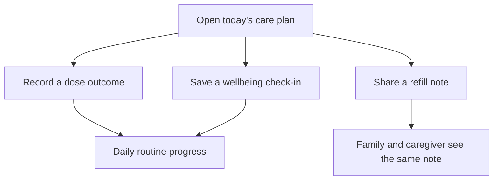
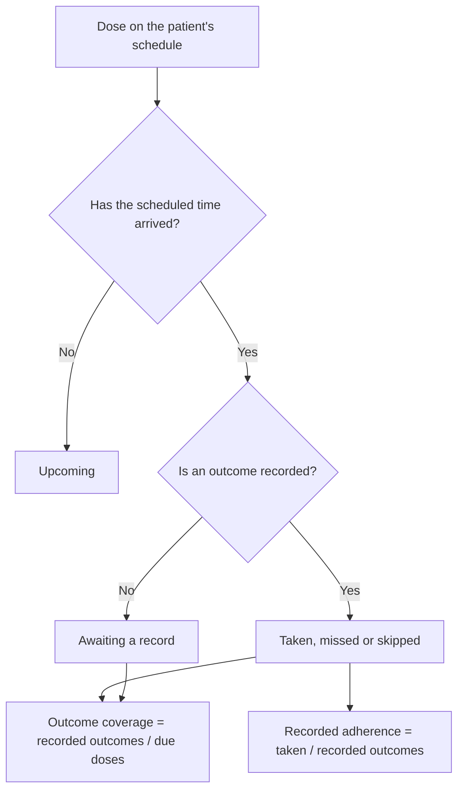
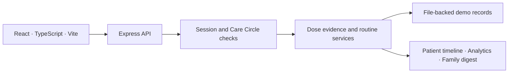

# Careverse

Careverse helps older adults, families, and caregivers coordinate medication schedules, wellbeing check-ins, and appointments. Its reports show the records behind each number so a caregiver can see what happened and where they still need to check in.

[Open the live demo](https://careversebynk.vercel.app/) · [Try the walkthrough](#demo-walkthrough) · [Run locally](#run-locally) · [Review the evidence](#verification)



## Demo walkthrough

1. Choose **Try the patient demo**. Open the wellbeing check-in, choose a mood and save it. Reopen it to review the saved answers.
2. Under **Care resources**, open **Medication supply** and choose **Share refill note**. Open **Menu → Caregiver** to find that prescription in **Shared care notes**. A second attempt on the same day reuses the existing note.
3. Open **Appointments** to schedule a visit, check off a preparation task and export the visit to a calendar. Past visits remain in **Visit history** with their recorded status.
4. Open **Analytics & Reports**, select a period and inspect a day. **Download dose log** exports the patient’s history. Family members can review the same activity in their digest.

The menu includes larger text, high contrast, and English, Tamil, and Hindi interface options. The patient, family, caregiver, and admin views adapt to phone and desktop widths.

## What Careverse tracks

| Workflow | How it works |
| --- | --- |
| Medication routine | Record taken or skipped doses, inspect the timeline, and estimate full days of supply and share refill notes. |
| Adherence reports | Compare 7-, 14-, and 30-day periods, inspect individual days, and see recurring gaps by time slot. |
| Wellbeing and appointments | Log a daily check-in, review a visit checklist, and export appointment reminders to a calendar. |
| Care Circle | Invite family or caregivers with expiring passcodes, approve requests, and set permissions. |
| CareBuddy | Summarize recorded routines and prepare appointment questions using the patient’s stored records. Ask “What pills do I have left today?” to see unrecorded and upcoming doses in local time. Missed-dose advice questions direct the user to a prescriber or pharmacist. |
| Demo operations | Four role-based accounts, a simulated inbox, and an SOS confirmation flow. Use fictional information in the public deployment. |

## How the numbers are calculated



Careverse groups dose records by the patient’s local calendar day. The report includes a dose once its scheduled time has passed. Future doses remain visible in the daily schedule.

- **Recorded adherence** divides taken doses by the total with a taken, missed, or skipped outcome. With zero recorded outcomes, the report shows **No outcomes**.
- **Outcome coverage** divides recorded outcomes by the number of due doses. Doses that are due and lack an outcome are shown as **Awaiting a record**.
- **Daily routine progress** counts due doses and one wellbeing check-in as routine items. A taken dose and a recorded check-in each complete one item. The app shows **Awaiting activity** until it has an outcome or check-in to report.
- **Time-slot patterns** use recorded outcomes from active prescriptions over the last 14 patient-local days.

These figures measure recorded care activities. Clinical assessment, medication decisions, and emergency response require the appropriate healthcare professionals or emergency services.

## Verification

The checks below run on fixed synthetic records. They measure the outputs described above.

| Suite | Previous version | Updated version |
| --- | ---: | ---: |
| [Adherence scenarios](server/tests/unit/adherenceAccuracy.test.ts) | 4 of 15 at `52bff56` | 15 of 15 |
| [Care-plan workflow scenarios](server/tests/integration/carePlanWorkflows.test.ts) | 0 of 11 at `a705b85` | 11 of 11 |
| [CareBuddy schedule questions](server/tests/unit/careBuddySchedule.test.ts) | 0 of 7 at `8466c5f` | 7 of 7 |
| [Daily care evidence scenarios](server/tests/unit/careEvidenceAccuracy.test.ts) | 1 of 11 at `23af8e0` | 11 of 11 |

The regression suite passes 124 automated tests across the server and client. The care-plan scenarios exercise a newly added prescription, pause and resume, as-needed medication, retained dose history, refill handoffs, visit classification, daylight-saving transitions and simulated SOS delivery. The [time-zone tests](server/tests/unit/patientSchedule.test.ts) also cover India and Nepal, leap day and the change between summer and winter offsets.

Browser checks covered patient check-in edits, a refill note read by family and caregiver, a caregiver handoff, visit creation and cancellation, the checklist, calendar export, and all four demo dashboards. Nine routes were checked at six widths from 320 to 1440 px for horizontal overflow.

```sh
npm test
npm exec --workspace=server -- vitest run tests/unit/adherenceAccuracy.test.ts tests/unit/careEvidenceAccuracy.test.ts
npm run build
```

## Run locally

Use Node.js 24 LTS with npm.

```sh
git clone https://github.com/NateshKannaR/Careverse.git
cd Careverse
npm ci
```

Run these commands in separate terminals.

```sh
npm run dev:server
```

```sh
npm run dev:client
```

Open [localhost:5173](http://localhost:5173). Vite forwards API requests to the Express server on port 5000. The local demo uses seeded records. Email stays in the simulator when `RESEND_API_KEY` is unset.

## Architecture



| Path | Contents |
| --- | --- |
| [client/src](client/src) | Dashboards, responsive navigation, forms, and analytics |
| [server/src/routes](server/src/routes) | Authenticated API routes and public demo sign-in |
| [server/src/services](server/src/services) | Adherence, daily routine, refill, and assistant logic |
| [server/tests](server/tests) | Unit and request-level integration suites |
| [database](database) | SQL schema and seed assets |

## Deploy on Vercel

Use the repository root and the **Other** framework preset. [`vercel.json`](vercel.json) installs the workspace dependencies and builds the static frontend plus one Express function. After deployment, verify [the login route](https://careversebynk.vercel.app/login) and [API health](https://careversebynk.vercel.app/api/health).

Set a unique `JWT_SECRET` for your project. The Vercel function stores demo data in temporary storage. Function restarts may reset those records. Opening a care plan generates the current day’s scheduled doses. The standalone server runs the background reminder loop. The hosted demo supports on-demand reminder simulations. Refill handoffs remain inside Careverse. The SOS confirmation reports provider submissions and simulations separately.

The package metadata declares the MIT license. Careverse was built for the Intelligent Elderly Healthcare Ecosystem Challenge.
