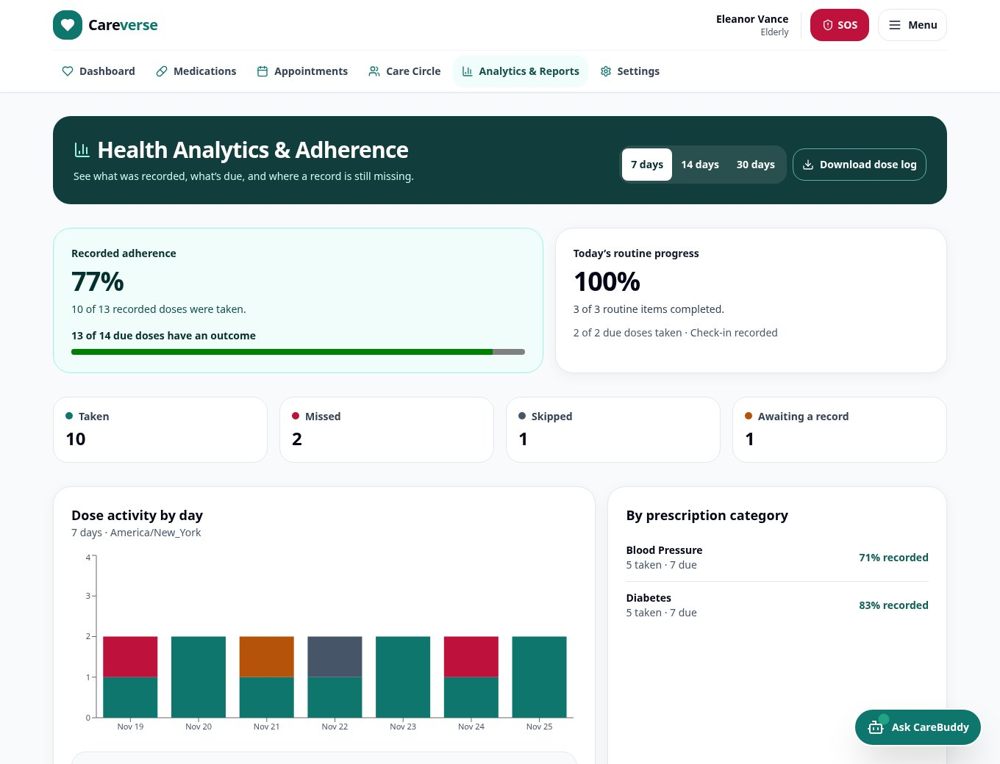
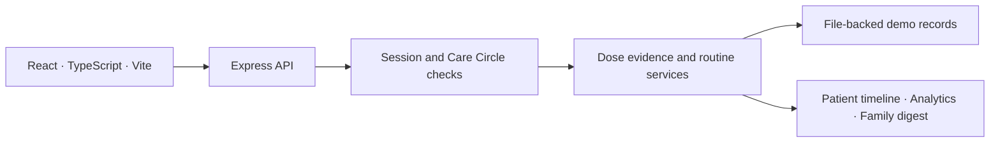

# Careverse

Careverse helps older adults, families, and caregivers coordinate medication schedules, wellbeing check-ins, and appointments. Its reports show the records behind each number so a caregiver can see what happened and where they still need to check in.

[Open the live demo](https://careversebynk.vercel.app/) · [Try the walkthrough](#demo-walkthrough) · [Run locally](#run-locally) · [Review the evidence](#verification)



## Demo walkthrough

1. Open [Careverse](https://careversebynk.vercel.app/) and choose **Patient** under **Explore the demo**. The public demo uses fictional accounts and dose history.
2. Open **Analytics & Reports**. Compare **Recorded adherence** with **Due doses with a recorded outcome**. The first shows the proportion taken among logged outcomes. The second shows how much of the schedule has been accounted for.
3. Switch from **7 days** to **14 days**, then use **Inspect a day** to read the exact counts behind the chart. **Download dose log** exports the authenticated patient’s dose history as a CSV.
4. Choose **Family** from the **Menu**. The daily digest uses the same records as the patient’s routine summary. Use **CareBuddy** to review the routine or prepare questions for an upcoming visit.

The menu includes larger text, high contrast, and English, Tamil, and Hindi interface options. The patient, family, caregiver, and admin views adapt to phone and desktop widths.

## What Careverse tracks

| Workflow | How it works |
| --- | --- |
| Medication routine | Record taken or skipped doses, inspect the timeline, and estimate refill dates from the remaining supply. |
| Adherence reports | Compare 7-, 14-, and 30-day periods, inspect individual days, and see recurring gaps by time slot. |
| Wellbeing and appointments | Log a daily check-in, review a visit checklist, and export appointment reminders to a calendar. |
| Care Circle | Invite family or caregivers with expiring passcodes, approve requests, and set permissions. |
| CareBuddy | Summarize recorded routines and prepare appointment questions using the patient’s stored records. Dosing questions are directed to the prescriber or pharmacist. |
| Demo operations | Four role-based accounts, a simulated inbox, and an SOS confirmation flow. Use fictional information in the public deployment. |

## How the numbers are calculated

Careverse groups dose records by the patient’s local calendar day. The report includes a dose once its scheduled time has passed. Future doses remain visible in the daily schedule.

- **Recorded adherence** divides taken doses by the total with a taken, missed, or skipped outcome. With zero recorded outcomes, the report shows **No outcomes**.
- **Outcome coverage** divides recorded outcomes by the number of due doses. Doses that are due and lack an outcome are shown as **Awaiting a record**.
- **Daily routine progress** counts due doses and one wellbeing check-in as routine items. A taken dose and a recorded check-in each complete one item. The app shows **Awaiting activity** until it has an outcome or check-in to report.
- **Time-slot patterns** use recorded outcomes from active prescriptions over the last 14 patient-local days.

These figures measure recorded care activities. Clinical assessment, medication decisions, and emergency response require the appropriate healthcare professionals or emergency services.

## Verification

The checks below run on fixed synthetic records. They measure the outputs described above.

| Suite | Previous version | Updated version |
| --- | ---: | ---: |
| [Adherence scenarios](server/tests/unit/adherenceAccuracy.test.ts) | 4 of 15 at `52bff56` | 15 of 15 |
| [Daily care evidence scenarios](server/tests/unit/careEvidenceAccuracy.test.ts) | 1 of 11 at `23af8e0` | 11 of 11 |

The full build passed 96 automated tests. Browser checks exercised the period selector, daily breakdown, authenticated CSV, and layouts from 320 to 1440 px. The daily-care cases cover skipped doses, missing outcomes, future doses, local midnight, the repeated daylight-saving hour, and the assistant’s recap. [API integration tests](server/tests/integration/adherenceReport.test.ts) check agreement across the timeline and score, invalid dates, and authenticated CSV exports.

```sh
npm test
npm exec --workspace=server -- vitest run tests/unit/adherenceAccuracy.test.ts tests/unit/careEvidenceAccuracy.test.ts
npm run build
```

## Run locally

Use Node.js 24 LTS with npm.

```sh
git clone https://github.com/NateshKannaR/Careverse.git
cd Careverse
npm ci
```

Run these commands in separate terminals.

```sh
npm run dev:server
```

```sh
npm run dev:client
```

Open [localhost:5173](http://localhost:5173). Vite forwards API requests to the Express server on port 5000. The local demo uses seeded records. Email stays in the simulator when `RESEND_API_KEY` is unset.

## Architecture



| Path | Contents |
| --- | --- |
| [client/src](client/src) | Dashboards, responsive navigation, forms, and analytics |
| [server/src/routes](server/src/routes) | Authenticated API routes and public demo sign-in |
| [server/src/services](server/src/services) | Adherence, daily routine, refill, and assistant logic |
| [server/tests](server/tests) | Unit and request-level integration suites |
| [database](database) | SQL schema and seed assets |

## Deploy on Vercel

Use the repository root and the **Other** framework preset. [`vercel.json`](vercel.json) installs the workspace dependencies and builds the static frontend plus one Express function. After deployment, verify [the login route](https://careversebynk.vercel.app/login) and [API health](https://careversebynk.vercel.app/api/health).

Set a unique `JWT_SECRET` for your project. The Vercel function stores demo data in temporary storage. Function restarts may reset those records. The standalone server runs the scheduled reminder loop.

The package metadata declares the MIT license. Careverse was built for the Intelligent Elderly Healthcare Ecosystem Challenge.
